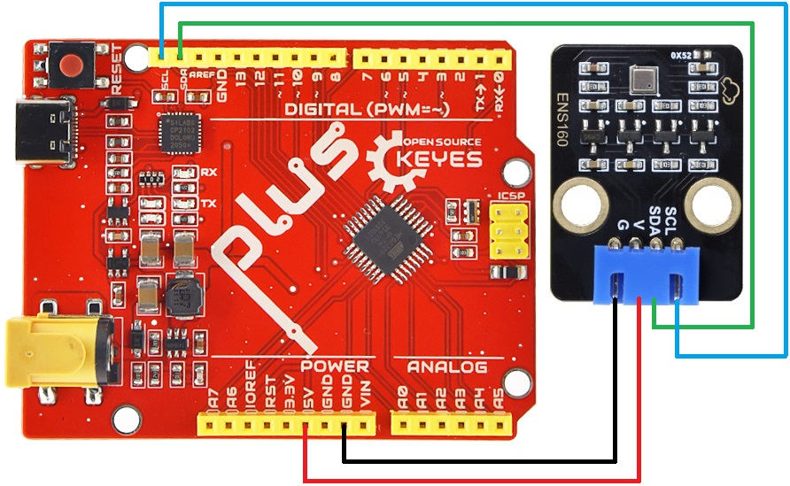
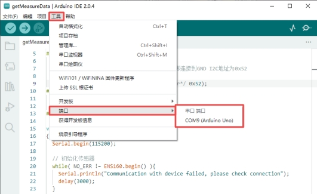
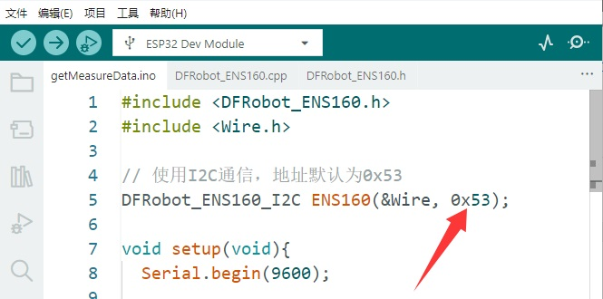
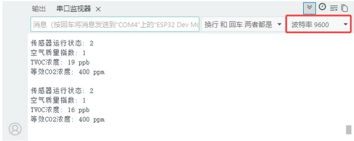

# ENS160 空气质量传感器 TVOC、eCO2、AQI 黑色环保


## 概述

ENS160 空气质量传感器搭载了ScioSense公司新推出ENS160空气质量传感器。该传感器专为室内空气质量检测而设计，能直接输出多种IAQ（TVOC、eCO2、AQI）数据。创新的TrueVOC技术结合金属氧化物(MOX)技术使得该传感器有优越准确性、快速响应、抗干扰等特性。

ENS160空气质量传感器内置算法，直接输出TVOC、eCO2、AQI数据，环境数据更丰富、容易理解。该传感器的预热时间小于3分钟，可以更快速的获得准确数据，内置基线自动校准算法，确保了传感器的长期稳定性。


## 特点

- 多种IAQ输出(TVOC、eCO2、AQI)，环境数据丰富

- 预热时间小于三分钟，更快获取数据

- 内置算法，输出数据更准确

- 自动校准基线，长期使用更稳定


## 规格参数

| 供电电压     | 3.3 V~5.5 V       |
| ------------ | ----------------- |
| 工作电流     | 29 mA             |
| 预热时间     | <3分钟            |
| 接口方式     | I2C               |
| I2C地址      | 0x52、0x53        |
| 工作温度范围 | -10℃~65℃          |
| 工作湿度范围 | 5 %RH~95 %RH      |
| eCO2测量范围 | 400 ppm~65000 ppm |
| TVOC测量范围 | 0 ppb~65000 ppb   |
| 模块接口     | 4P XH-2.54接口    |
| 过孔直径     | 4.8mm             |
| 尺寸         | 30mm×20mm×7.5mm   |
| 重量         | 2.4g              |


## 引脚介绍

### ENS160传感器模块引脚介绍：


### ENS160引脚介绍：

当ENS160 传感器的 I2C ADDR 引脚高电平时，地址是 `0x53` ；当 ADDR 引脚低电平时，地址是 `0x52` 。本 ENS160 传感器模块设计时将 I2C ADDR 引脚拉高，I2C地址默认为 `0x53` 。

同时，本模块上留有 I2C ADDR 引脚拉低的空焊盘，若有需要**可自行更换地址**。方法如下：

在本模块I2C ADDR引脚拉低的空焊盘处（下图箭头所指处）焊接一个封装为 0603 的 0 欧电阻。


然后将示例代码 getMeasureData.ino 中相关部分的地址 `0x53` 更改为 `0x52` 。


更多具体介绍可参考ENS160的规格书。


## 空气质量参考指标

**空气质量指数（AQI）等级参考**

| AQI-UBA指数 | AQI-UBA等级 | 建议                       |
| ----------- | ----------- | -------------------------- |
| 11          | 非常好      | 没有建议                   |
| 2           | 好          | 保持充分通风               |
| 3           | 一般        | 加强通风，靠近水源         |
| 4           | 差          | 加强通风寻找污染源         |
| 5           | 极差        | 在不可避免情况下请加强通风 |


**二氧化碳（eCO2/CO2）浓度参考**

| eC02/C02  | 等级   | 结果/建议                 |
| --------- | ------ | ------------------------- |
| 400-600   | 非常好 | 没有建议                  |
| 600-800   | 好     | 保持正常                  |
| 800-1000  | 一般   | 可以通风                  |
| 1000-1500 | 差     | 室内空气污染/建议通风     |
| 21500     | 严重   | 室内空气污染严重/需要通风 |


**总挥发性有机化合物（TVOC）浓度参考**

| TVOC浓度(ppb) | 人体反应             |
| ------------- | -------------------- |
| <50           | 正常                 |
| 50-750        | 可能急躁不安和不舒服 |
| 750-6000      | 可能急躁不安和头疼   |
| >6000         | 产生头痛等神经问题   |


## 尺寸图


## Arduino使用教程

### 硬件准备

- Arduino UNO PLUS主控板   X1

- ENS160 空气质量传感器          X1

- 公对母杜邦线               若干


### 软件准备

- Arduino IDE 2.0.4

下载Arduino IDE参考Arduino的官方网站：[Software | Arduino](https://www.arduino.cc/en/software/)

### 接线图

按照接线图将模块用杜邦线正确连接至主控板，再将主控板用USB线连接至电脑，打开Arduino IDE 2.0.4，查看是否有端口。若无端口，检查是否安装驱动。有端口，则继续往下进行。





**注意：** 若使用其它主板，连接至其对应的SCL、SDA接口即可。


### 上传代码

| 传感器运行状态 | 解释                                                         |
| -------------- | ------------------------------------------------------------ |
| 0              | 正常运行                                                     |
| 1              | 预热，上电后前3分钟（需传感器不再出现初次启动状态）          |
| 2              | 初次启动，上电后前1小时（传感器连续工作24小时后将不再出现该状态，如果中途出现断电，重新上电后传感器仍会进入初次启动状态） |

```c++
#include <DFRobot_ENS160.h>
#include <Wire.h>

// 使用I2C通信，地址默认为0x53
DFRobot_ENS160_I2C ENS160(&Wire, 0x53);

void setup(void){
  Serial.begin(9600);

  // 初始化传感器
  while(NO_ERR != ENS160.begin()) {
    Serial.println("与设备的通信失败，请检查连接情况.");
    delay(3000);
  }
  Serial.println("开始好的!");

  // 设置电源模式为标准气体感应模式
  ENS160.setPWRMode(ENS160_STANDARD_MODE);

  // 设置环境温度和湿度用于校准（示例值：25°C，50%RH）
  ENS160.setTempAndHum(25.0, 50.0);
}

void loop(){
  // 获取传感器工作状态
  uint8_t Status = ENS160.getENS160Status();
  Serial.print("传感器运行状态: ");
  Serial.println(Status);

  // 获取空气质量指数(1-5)
  uint8_t AQI = ENS160.getAQI();
  Serial.print("空气质量指数: ");
  Serial.println(AQI);

  // 获取TVOC浓度(0-65000 ppb)
  uint16_t TVOC = ENS160.getTVOC();
  Serial.print("TVOC浓度: ");
  Serial.print(TVOC);
  Serial.println(" ppb");

  // 获取等效CO2浓度(400-65000 ppm)
  uint16_t ECO2 = ENS160.getECO2();
  Serial.print("等效CO2浓度: ");
  Serial.print(ECO2);
  Serial.println(" ppm");

  Serial.println();
  delay(1000);
}

```


**本 ENS160 传感器模块已将 I2C ADDR 引脚拉高，所以地址默认为 `0x53` 。**



### 代码解释

1\. 头文件引入和初始化库配置

```c++
#include <DFRobot_ENS160.h>
#include <Wire.h>

DFRobot_ENS160_I2C ENS160(&Wire, 0x53);
```
- `DFRobot_ENS160_I2C ENS160(&Wire, 0x53)`：创建 ENS160 传感器对象

- 使用 I2C 通信（&Wire）

- 传感器地址为 0x53（默认地址）


2\. 初始化设置(setup函数)

```c++
void setup(void){
  Serial.begin(9600);

  // 初始化传感器
  while(NO_ERR != ENS160.begin()) {
    Serial.println("与设备的通信失败，请检查连接情况.");
    delay(3000);
  }
  Serial.println("开始好的!");

  // 设置电源模式为标准气体感应模式
  ENS160.setPWRMode(ENS160_STANDARD_MODE);

  // 设置环境温度和湿度用于校准（示例值：25°C，50%RH）
  ENS160.setTempAndHum(25.0, 50.0);
}
```

**传感器初始化：**

- `ENS160.begin()`：尝试初始化传感器

- 使用 while 循环持续尝试，直到初始化成功

- 每次失败后等待 3 秒（delay(3000)）

**工作模式设置：**

- `setPWRMode(ENS160_STANDARD_MODE)`：设置传感器为标准工作模式

环境参数设置：

- `setTempAndHum(25.0, 50.0)`：提供环境温度和湿度，用于传感器校准和补偿


3\. 主循环(loop函数)

```c++
void loop(){
  // 获取传感器工作状态
  uint8_t Status = ENS160.getENS160Status();
  Serial.print("传感器运行状态: ");
  Serial.println(Status);

  // 获取空气质量指数(1-5)
  uint8_t AQI = ENS160.getAQI();
  Serial.print("空气质量指数: ");
  Serial.println(AQI);

  // 获取TVOC浓度(0-65000 ppb)
  uint16_t TVOC = ENS160.getTVOC();
  Serial.print("TVOC浓度: ");
  Serial.print(TVOC);
  Serial.println(" ppb");

  // 获取等效CO2浓度(400-65000 ppm)
  uint16_t ECO2 = ENS160.getECO2();
  Serial.print("等效CO2浓度: ");
  Serial.print(ECO2);
  Serial.println(" ppm");

  Serial.println();
  delay(1000);
}
```
- 首先，通过 `getENS160Status()` 获取传感器工作状态，确保设备正常运行。

- 然后依次读取三种关键参数：

    `getAQI()` 获取1-5级的综合空气质量指数

    `getTVOC()` 检测总挥发性有机物浓度

    `getECO2()` 测量等效二氧化碳值

- 最后，所有数据通过串口输出显示，并以 `delay(1000)` 控制每秒采集一次的频率，形成完整的空气质量监测循环。


### 运行结果

通过Arduino IDE将示例程序烧录到 Arduino UNO PLUS主控板，打开串口监视器，波特率选择9600，我们可以在串口监视器依次看到打印出的传感器状态、AQI等级以及TVOC、eCO2浓度。如下图所示：

⚠️ <span style="color: rgb(255, 76, 65);">特别提醒：如果串口监视器打印数据都是0，请按一下ESP32主控板上的复位键，等待几秒钟</span>。




## 常见问题

（1）识别不到开发板端口

答：是否已经安装驱动；接线端口有无接触不良，更换USB线测试。

（2）程序编译出错

答：选择对应的开发板型号，若是程序中用到库，需要添加库文件。

