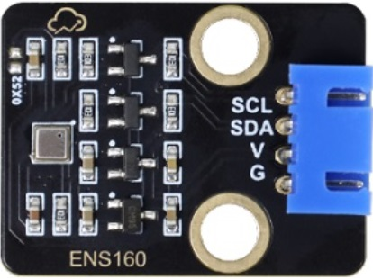
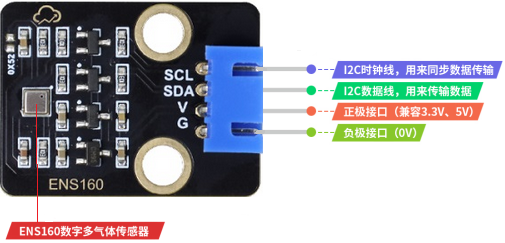
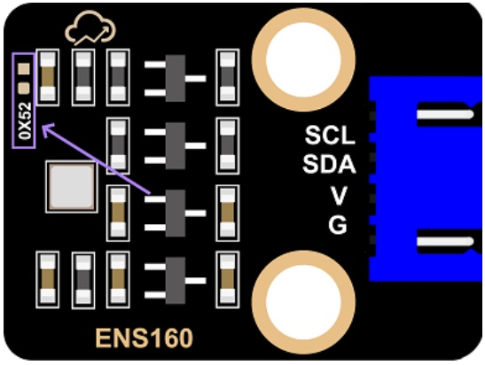
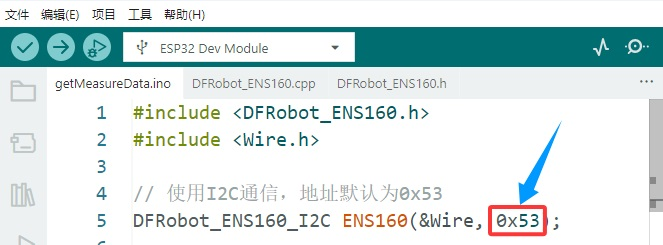
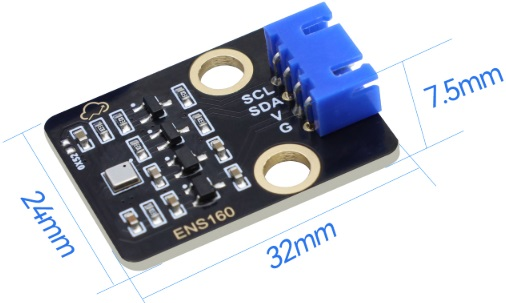

# ENS160 空气质量传感器 TVOC、eCO2、AQI 黑色环保

## 概述

ENS160 空气质量传感器搭载了ScioSense公司新推出ENS160空气质量传感器。该传感器专为室内空气质量检测而设计，能直接输出多种IAQ（TVOC、eCO2、AQI）数据。创新的TrueVOC技术结合金属氧化物(MOX)技术使得该传感器有优越准确性、快速响应、抗干扰等特性。

ENS160空气质量传感器内置算法，直接输出TVOC、eCO2、AQI数据，环境数据更丰富、容易理解。该传感器的预热时间小于3分钟，可以更快速的获得准确数据，内置基线自动校准算法，确保了传感器的长期稳定性。

## 特点

- 多种IAQ输出(TVOC、eCO2、AQI)，环境数据丰富

- 预热时间小于三分钟，更快获取数据

- 内置算法，输出数据更准确

- 自动校准基线，长期使用更稳定

## 规格参数

| 供电电压     | 3.3 V~5.5 V       |
| ------------ | ----------------- |
| 工作电流     | 29 mA             |
| 预热时间     | <3分钟            |
| 接口方式     | I2C               |
| I2C地址      | 0x52、0x53        |
| 工作温度范围 | -10℃~65℃          |
| 工作湿度范围 | 5 %RH~95 %RH      |
| eCO2测量范围 | 400 ppm~65000 ppm |
| TVOC测量范围 | 0 ppb~65000 ppb   |
| 模块接口     | 4P XH-2.54接口    |
| 过孔直径     | 4.8mm             |
| 尺寸         | 30mm×20mm×7.5mm   |
| 重量         | 2.4g              |

## 引脚介绍

### ENS160传感器模块引脚介绍：

### ENS160引脚介绍：

当ENS160 传感器的 I2C ADDR 引脚高电平时，地址是 `0x53` ；当 ADDR 引脚低电平时，地址是 `0x52` 。本 ENS160 传感器模块设计时将 I2C ADDR 引脚拉高，I2C地址默认为 `0x53` 。

同时，本模块上留有 I2C ADDR 引脚拉低的空焊盘，若有需要**可自行更换地址**。方法如下：

在本模块I2C ADDR引脚拉低的空焊盘处（下图箭头所指处）焊接一个封装为 0603 的 0 欧电阻。

在使用arduino的时候可以将示例代码 getMeasureData.ino 中相关部分的地址 `0x53` 更改为 `0x52` 。

更多具体介绍可参考ENS160的规格书。

## 空气质量参考指标

**空气质量指数（AQI）等级参考**

| AQI-UBA指数 | AQI-UBA等级 | 建议                       |
| ----------- | ----------- | -------------------------- |
| 11          | 非常好      | 没有建议                   |
| 2           | 好          | 保持充分通风               |
| 3           | 一般        | 加强通风，靠近水源         |
| 4           | 差          | 加强通风寻找污染源         |
| 5           | 极差        | 在不可避免情况下请加强通风 |

**二氧化碳（eCO2/CO2）浓度参考**

| eC02/C02  | 等级   | 结果/建议                 |
| --------- | ------ | ------------------------- |
| 400-600   | 非常好 | 没有建议                  |
| 600-800   | 好     | 保持正常                  |
| 800-1000  | 一般   | 可以通风                  |
| 1000-1500 | 差     | 室内空气污染/建议通风     |
| 21500     | 严重   | 室内空气污染严重/需要通风 |

**总挥发性有机化合物（TVOC）浓度参考**

| TVOC浓度(ppb) | 人体反应             |
| ------------- | -------------------- |
| <50           | 正常                 |
| 50-750        | 可能急躁不安和不舒服 |
| 750-6000      | 可能急躁不安和头疼   |
| >6000         | 产生头痛等神经问题   |

## 尺寸图

