# Mixly使用教程

## 资料下载
- 下载代码[getMeasureData(Mixly)](./getMeasureData(Mixly).7z)

## 硬件准备

- Arduino UNO PLUS主控板   X1

- ENS160 空气质量传感器          X1

- 公对母杜邦线               若干

## 软件下载准备

- Mixly 3.0RC0

下载教程可以参考以下网址：[Software | Mixly](https://www.keyesrobot.cn/projects/mixly/zh-cn/)

## 软件库的添加
- 在代码路径下会有该传感器所需要的库文件

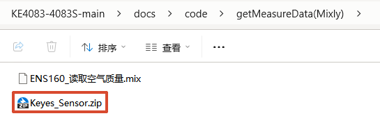

- 将其解压到当前文件夹

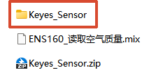

- 然后打开Mixly 3.0RC0点击右上角的设置，会出现一个管理库，点击管理库

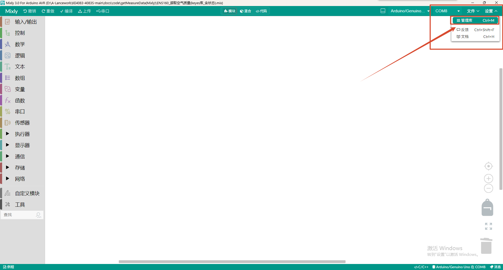

- 后面会出现一个库管理器，点击库管理器右上角的本地导入

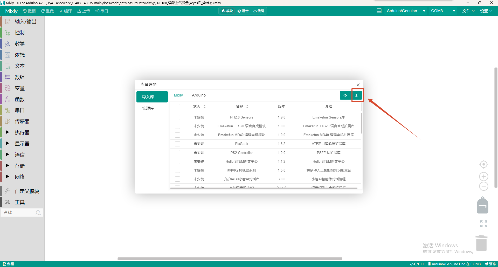

- 点击刚刚解压好的文件

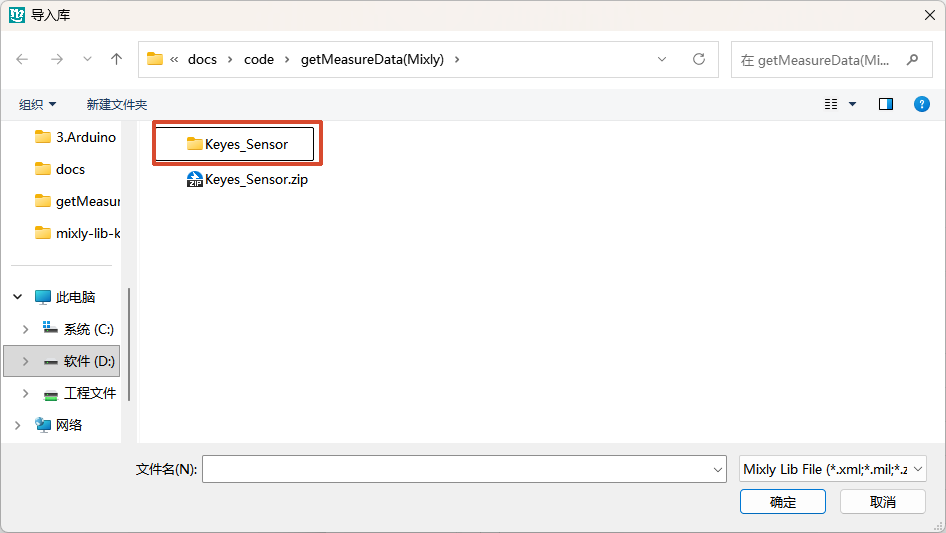

- 选择index.xml导入库

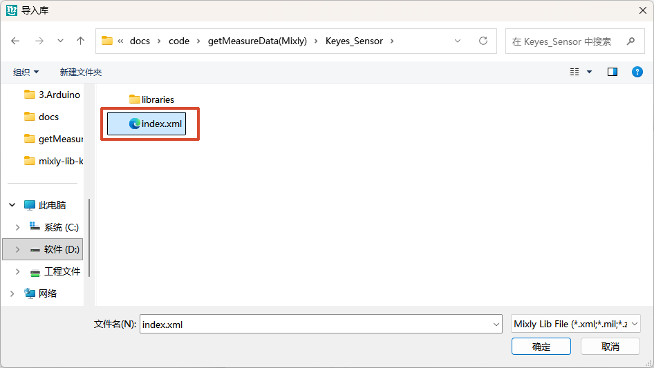

- 在管理库中出现`Keyes_Sensor`,并且左侧工具栏最下方出现了`传感器模块`,这就说明传感器的库文件导入成功了。

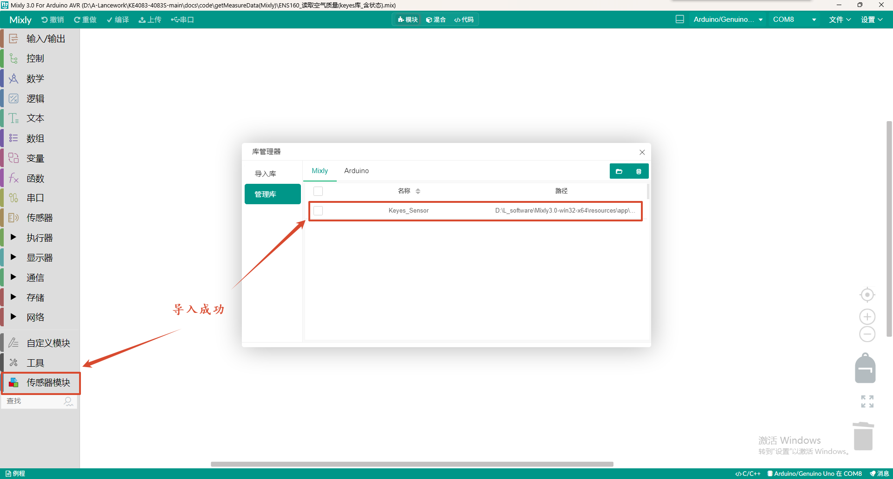

## 接线图

- 按照接线图将模块用杜邦线正确连接至主控板，再将主控板用USB线连接至电脑

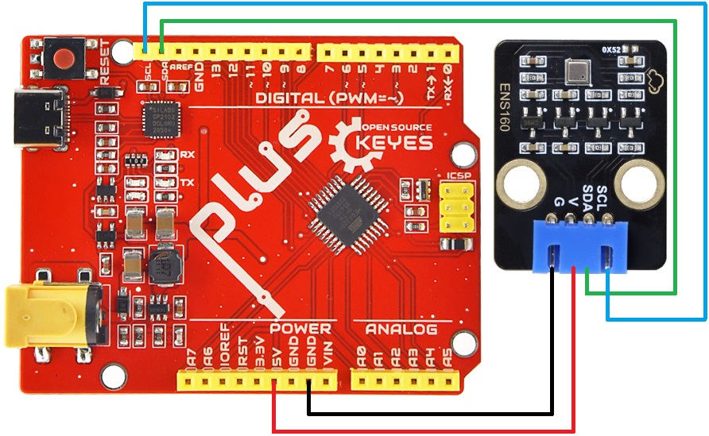

- 打开Mixly 3.0RC0，选择Arduino AVR点击进去

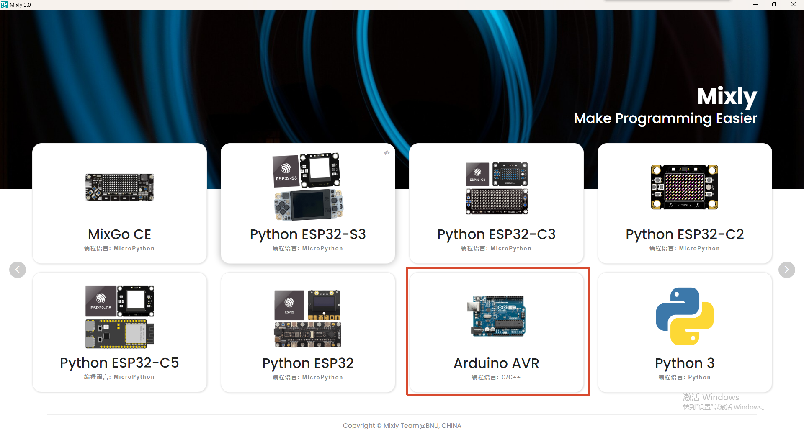

- 进入界面之后查看是否有端口；若无端口，检查是否安装驱动。有端口，则继续往下选择开发板类型。

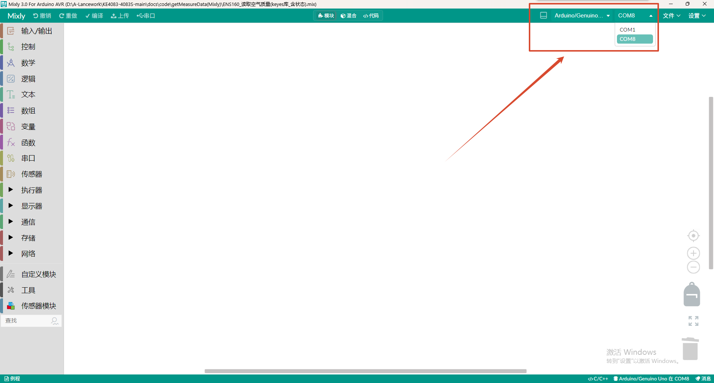

- Arduino UNO PLUS主控板选择`Arduino/Genuino Uno`

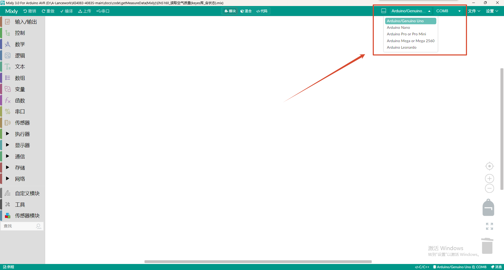

**注意：** 若使用其它主板，连接至其对应的SCL、SDA接口即可，每个电脑连接的端口名称并不是一致的，要留意插上USB线之后多出来的端口。

## 上传代码

| 传感器运行状态 | 解释 |
|---|---|
| 0 | 正常运行 |
| 1 | 预热，上电后前 3 分钟（需传感器不再出现初次启动状态） |
| 2 | 初次启动，上电后前 1 小时（传感器连续工作 24 小时后将不再出现该状态，如果中途出现断电，重新上电后传感器仍会进入初次启动状态） |
| 3 | 输出无效，芯片检测到异常（检查 SDA/SCL 接线与供电，必要时按复位键重新上电） |

**完整代码：**
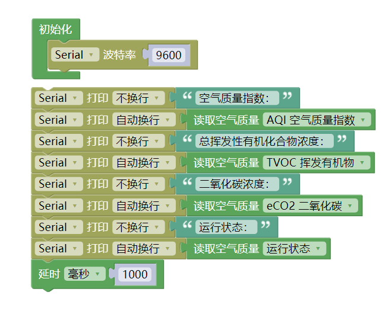

## 代码说明

**1.初始化设置**
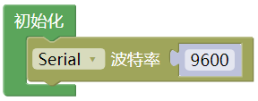

- 初始化串口通信，设置波特率为9600

**2.空气质量传感器积木块**

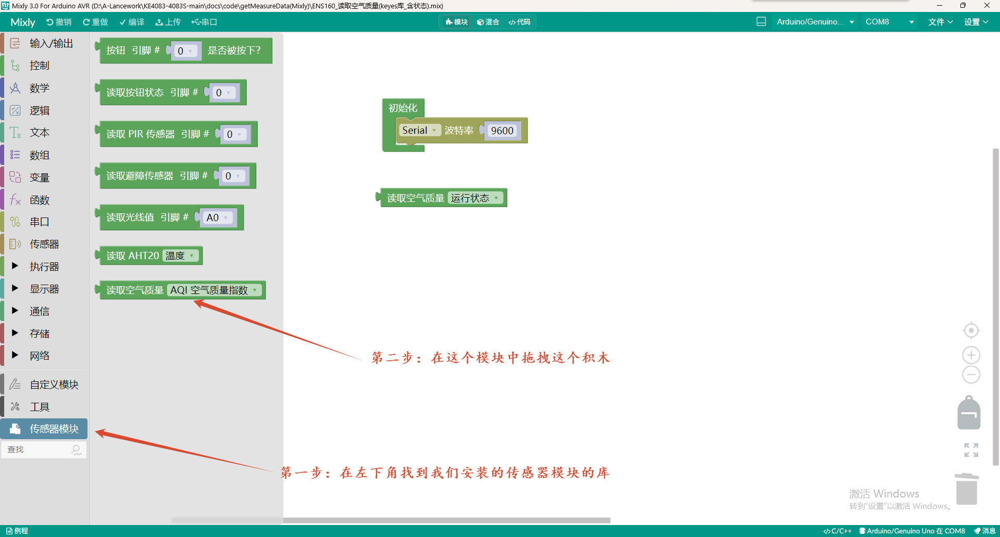
打开 Mixly，在左侧工具箱最下方找到 **「传感器模块」** 分类，里面最后一个积木就是 **「读取空气质量」**。
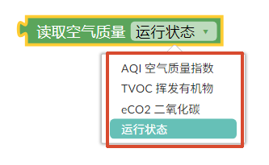

这个积木右侧有一个下拉框，可以切换四种数据类型：
| 下拉选项         | 读出的是什么                              |
| ---------------- | ----------------------------------------- |
| AQI 空气质量指数 | 1 ~ 5 的等级                              |
| TVOC 挥发有机物  | 总挥发性有机物浓度（ppb）                 |
| eCO2 二氧化碳    | 等效二氧化碳浓度（ppm）                   |
| 运行状态         | 0 正常 / 1 预热 / 2 初次启动 / 3 输出无效 |

**3.主循环**

- 主循环中我们会使用到积木块的寻找路径如图所示

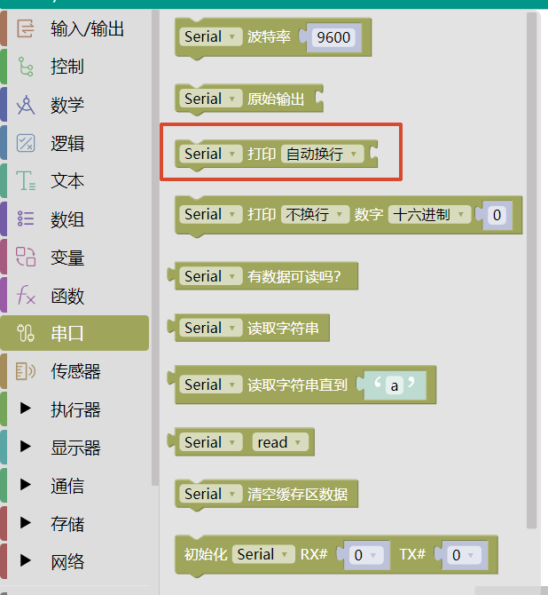

- 文本积木块

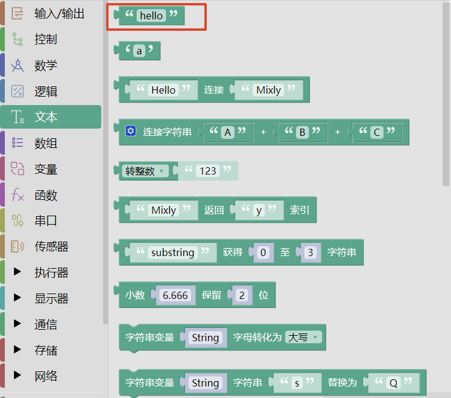

- 时间延时的积木块

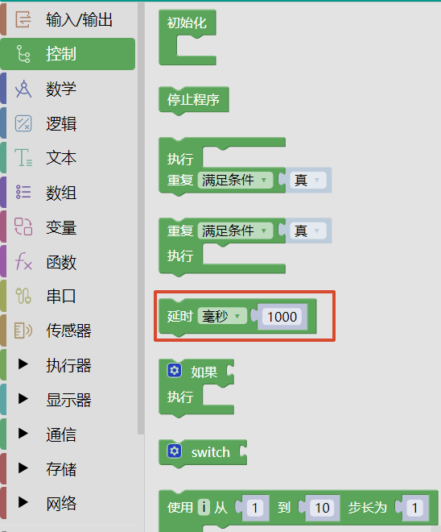

- 将他们拼在一起可以组成最后的主循环

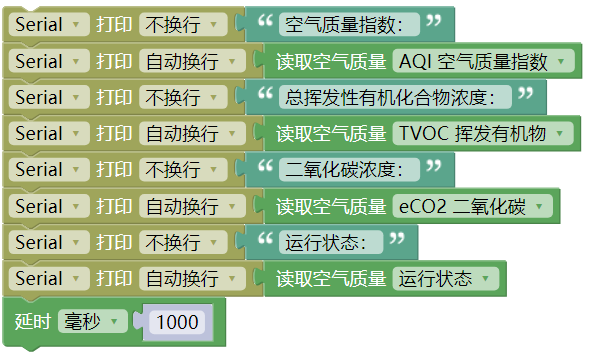

**主循环的代码讲解:**
- 首先，通过 `getAQI()` 获取 1~5 级的综合空气质量指数，判断当前空气的等级。

然后依次读取另外两项关键参数：

- `getTVOC()` 检测总挥发性有机物浓度；
- `getECO2()` 测量等效二氧化碳浓度。

接着用 `getFlags()` 读取传感器的运行状态，确认芯片已经脱离预热、进入正常工作阶段（0 正常 / 1 预热 / 2 初次启动 / 3 输出无效）。

每个参数的输出都先用 `Serial.print()` 打印中文标签、再用 `Serial.println()` 打印数值，保证"标签 + 数值"显示在同一行，四个指标各占一行，便于观察。

最后，以 `delay(1000)` 控制每秒采集一次的频率，形成完整的空气质量监测循环。

- 文件中也有提供**代码**的工程文件可以导入

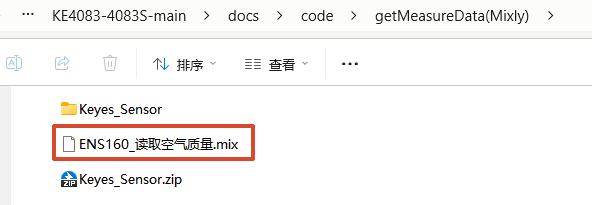

- 可以直接在Mixly软件内点击右上角的文件，选择`打开`

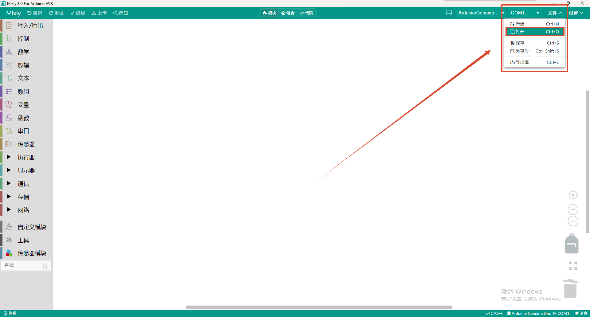

- 选择工程文件打开即可

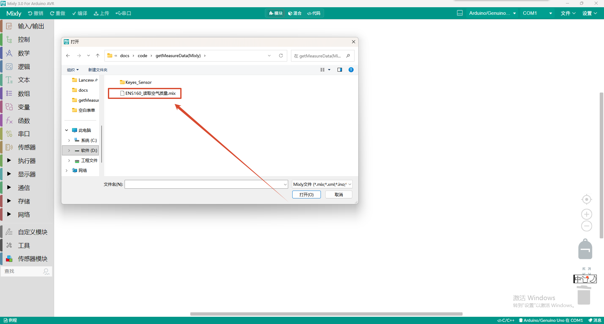

## 运行结果

通过Mixly 3.0RC0将示例程序烧录到 Arduino UNO PLUS主控板，打开串口监视器，波特率选择9600，我们可以在串口监视器依次看到打印出的传感器状态、AQI等级以及TVOC、eCO2浓度。如下图所示：

⚠️ 特别提醒：如果串口监视器打印数据都是0，请按一下Arduino UNO PLUS主控板上的复位键，等待几秒钟。
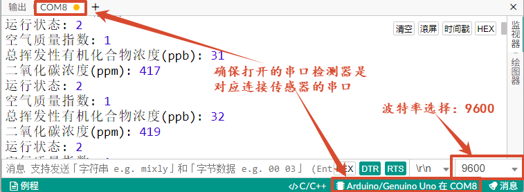

## 常见问题

（1）左侧工具栏找不到「传感器模块」分类

答：先确认库是否真的导入成功。点击右上角「设置 → 管理库」，在列表里看有没有 `Keyes_Sensor`。

- 列表里没有：重新导入，注意要选 **`index.xml`**（或 `Keyes_Sensor.zip`），不要直接选整个文件夹；
- 列表里有但左侧没出现：**完全退出 Mixly**（任务栏右键关闭，不是只关窗口）再重新打开。积木分类是软件启动时加载的。

（2）积木拖出来是空白方块，没有文字

答：扩展包的积木定义文件没加载。检查 `Keyes_Sensor` 目录下是否有这三项：`index.xml`、`main.bundle.js`、`libraries`。缺任何一项都要重新解压。

（3）识别不到开发板端口

答：按顺序排查：① 是否安装驱动② 换一根数据线（有些线只能充电不能传数据）；③ 换一个 USB 口后重新打开 Mixly；④ 在设备管理器「端口(COM 和 LPT)」里确认端口是否出现。

（4）开发板型号该选哪个

答：Arduino UNO PLUS 选 **`Arduino/Genuino Uno`**。它的主控是 ATmega328P、16 MHz，和官方 UNO 完全一致。不要选 Nano、Mega、Leonardo，它们的芯片或引脚映射不同。
