# Kidsblock使用教程

## 资料下载

- 下载代码 [getMeasureData(Arduino)](./getMeasureData（Kidsblock）.7z)

- Kidsblock的库ENS160传感器模块 [kidsblock_ens16传感器](./ks_ens160.7z)

## 硬件准备

- Arduino UNO PLUS主控板X1

- ENS160 空气质量传感器X1

- 公对母杜邦线若干

## 软件准备

下载Kidsblock IDE参考Kidsblock的网站：[Software | Kidsblock](https://www.keyesrobot.cn/projects/KidsBlock/)

## 接线图

按照接线图将模块用杜邦线正确连接至主控板，再将主控板用USB线连接至电脑，Kidsblock IDE ，查看是否有端口。若无端口，检查是否安装驱动。有端口，则继续往下进行。

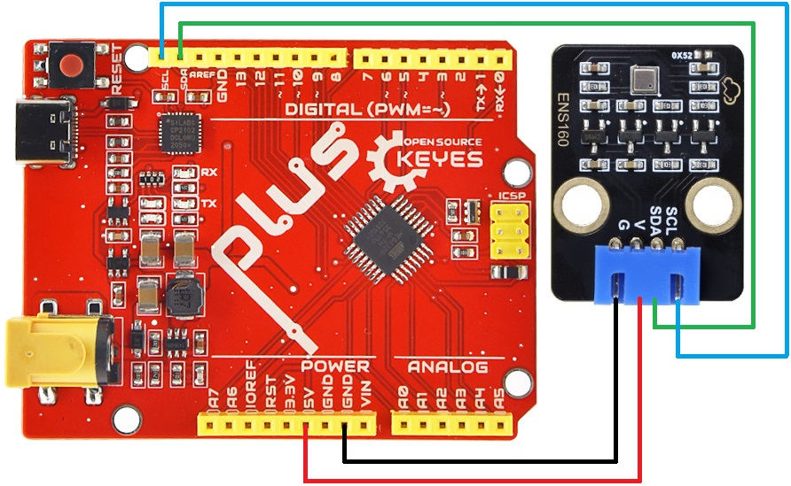

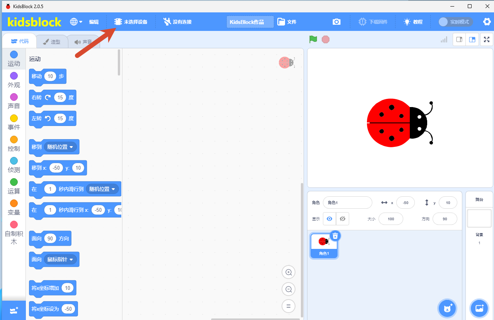
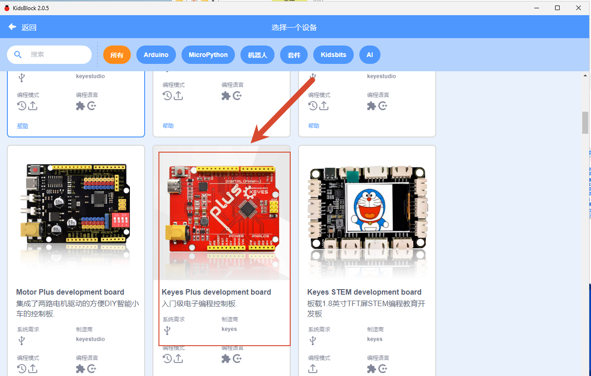

**注意：** 若使用其它主板，连接至其对应的SCL、SDA接口即可。如果在kidsblock里面看不到空气质量这个模块就去看KidsBlock_串口空气质量积木修改步骤这个步骤。

然后点击添加扩展,注意要在上传模式下点击

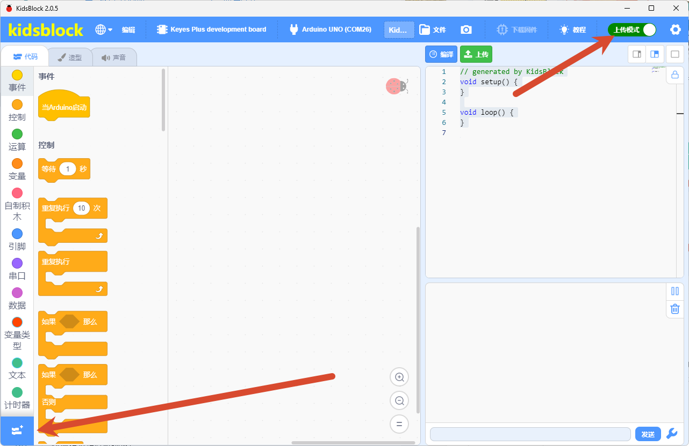

找到传感器部分选择ENS160空气质量传感器

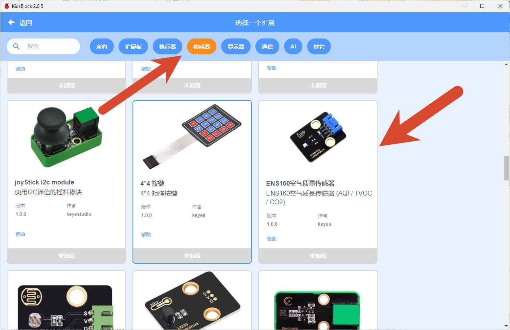

显示已加载表示添加成功（卸载这个扩展再次点击即可）

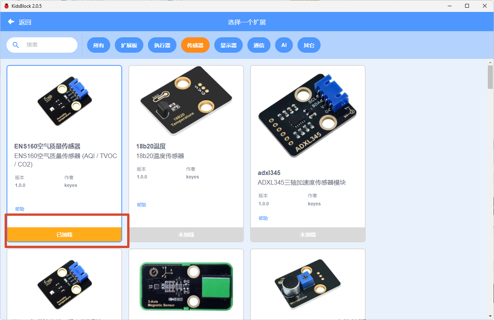

返回即可看到空气质量的模块，可选择输出什么数据
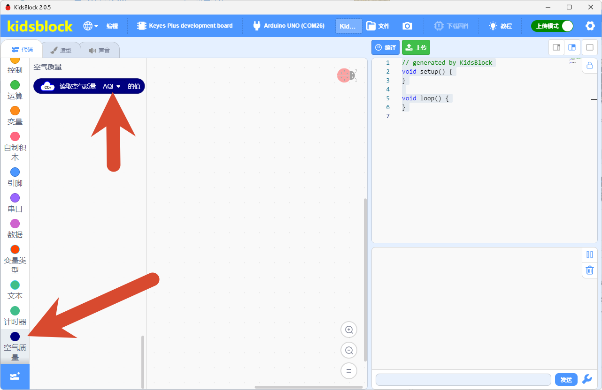

## 上传代码

| 传感器运行状态 | 解释                                                         |
| -------------- | ------------------------------------------------------------ |
| 0              | 正常运行                                                     |
| 1              | 预热，上电后前3分钟（需传感器不再出现初次启动状态）          |
| 2              | 初次启动，上电后前1小时（传感器连续工作24小时后将不再出现该状态，如果中途出现断电，重新上电后传感器仍会进入初次启动状态） |

## 代码说明

**1.   初始化设置**
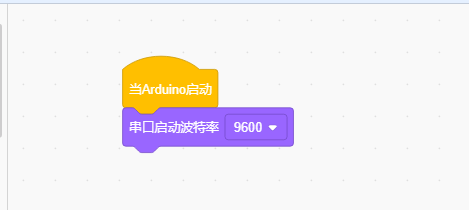

**2.  主循环**

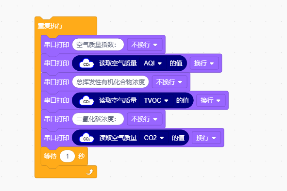

- 依次读取三种关键参数：

  获取1-5级的综合空气质量指数

  检测挥发性有机物浓度

  测量等效二氧化碳值

- 将数据通过串口输出显示，并以每秒采集一次的频率，形成完整的空气质量监测循环。

- 最后，所有数据通过串口输出显示，并以控制每秒采集一次的频率，形成完整的空气质量监测循环。
## 实验代码

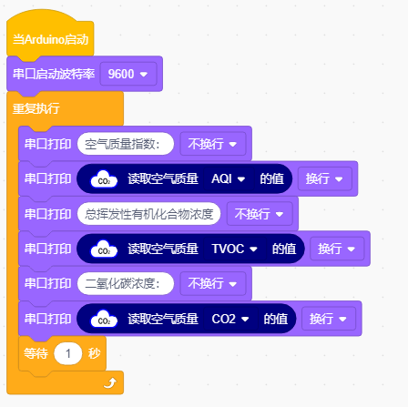

## 运行结果

外接电源，选择好正确的开发板板型和适当的串口端口（COMxx），然后单击按钮上传代码。上传代码成功后，单击KidsBlock IDE右下角的，设置串口波特率为 `9600`。

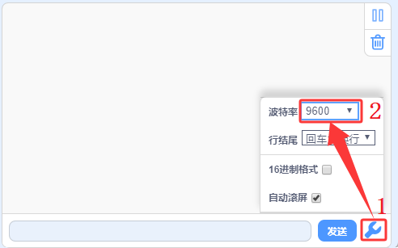

传感器首次上电需预热3-5分钟达到稳定，稳定后可以对着ENS160空气质量传感器哈气(吹气)，我们可以在串口监视器依次看到打印出的传感器状态、AQI等级以及TVOC、eCO2浓度。如下图所示：

⚠️ 特别提醒：如果串口监视器打印数据都是0，请按一下Arduino UNO PLUS主控板上的复位键，等待几秒钟。

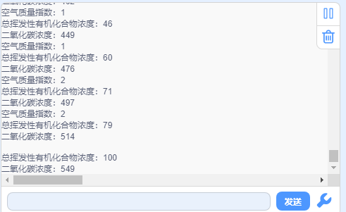

## 常见问题

（1）识别不到开发板端口

   - 是否已经安装驱动；接线端口有无接触不良，更换USB线测试。

（2）代码上传成功后串口监视器无任何信息打印？

   - 确保模块已接线且正确接线，然后按下主板的复位键：

     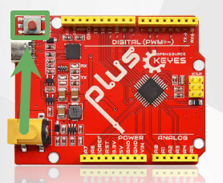
（3）如果找不到ens160传感器的话怎么办

   - 下载ks_ens160文件资料，然后把整个文件夹放进 %APPDATA%\KidsBlock\Data\external-resources\extensions\arduino\sensor\，完全重启整个软件后切上传模式，在扩展面板搜索 ENS160 并点卡片添加即可。

---

